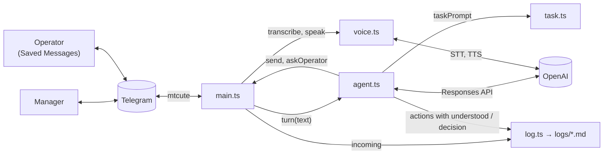
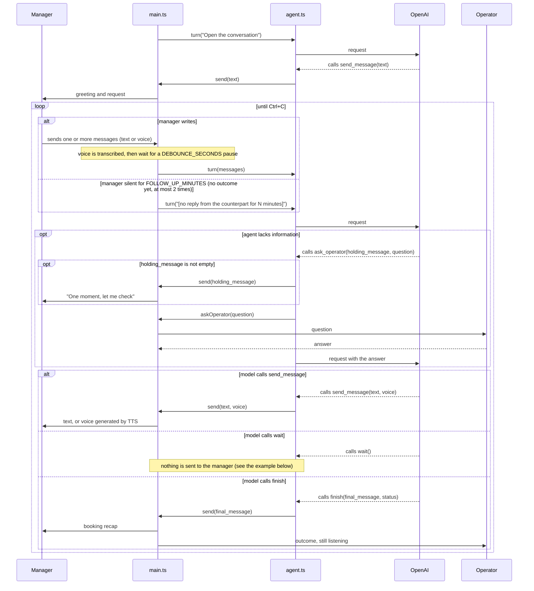
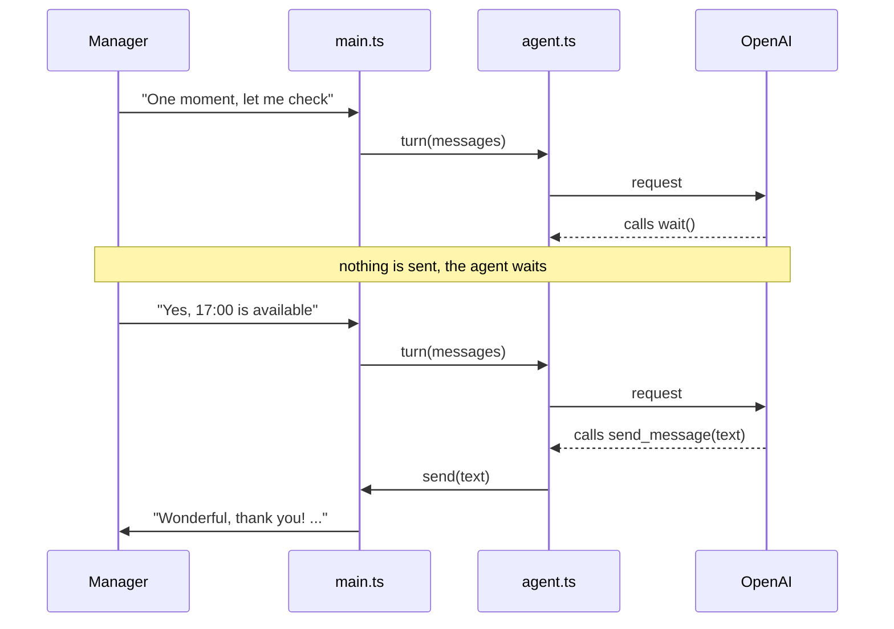

# Architecture

Three independent parts:

- **Channel** (`main.ts`) handles Telegram: incoming and outgoing messages, questions to the operator.
- **Brain** (`agent.ts`) is the LLM loop. It knows nothing about Telegram: it gets text and calls the `send` / `askOperator` functions it was given.
- **Task** (`task.ts`) is the prompt: goal, known and unknown facts, style, when to finish.

Changing the task means rewriting `task.ts`; changing the messenger means replacing the channel.

## Components

The agent is a **userbot**: a regular Telegram account over MTProto, because a Bot API bot cannot message a user first. The login is stored in `agent.mtcute.session`.

## Conversation

### Example: `wait`

The manager asks the agent to hold on. That message needs no reply, so the model calls `wait`, and the agent answers only when the manager writes again.

If the manager stays silent for `FOLLOW_UP_MINUTES` instead, the agent gets `[no reply from the counterpart for N minutes]` and may send one short, polite follow-up (at most twice).

### After `finish`

`finish` reports the outcome but doesn't close the chat. If the manager writes later (a change, a cancellation), the agent reacts, checks with the operator if needed (telling the manager it's checking via `holding_message`), and calls `finish` again with the updated outcome. The run ends only on `Ctrl+C`.

## Turn

Each step is one Responses API request with the rules + task prompt as `instructions`, the whole conversation as `input`, and `tool_choice: 'required'` with `parallel_tool_calls: false`: the model must take exactly one action through a tool.

| Tool | Effect | Turn |
|---|---|---|
| `send_message(text, voice)` | Message the manager as text or voice | ends |
| `ask_operator(holding_message, question)` | Optionally tell the manager "one moment, let me check", then ask the operator; the answer goes back to the model | continues |
| `wait()` | Send nothing: the latest message needs no reply (e.g. "one moment, let me check") | ends |
| `finish(final_message, status, summary)` | Send the final message, report the outcome to the operator; the chat stays open | ends |

Every tool also requires `understood` and `decision`; these make up the decision log. The model keeps no memory, so the agent stores the history (messages, calls and their results linked by `call_id`) and sends it in full every time. A turn is capped at 8 steps.

## Errors

- A failing tool (e.g. Telegram can't send a message) returns `error: …` to the model as the tool's result, so the history stays valid, and the model gets another step to retry or ask the operator.
- Any other failure in a turn (e.g. OpenAI unavailable after the SDK's retries) is logged and reported to the operator; the agent keeps listening, and the next manager message starts a new turn with the history intact.

## Operator

When the agent lacks information about its own side, it posts `🤖 Agent asks: …` to the account's Saved Messages and treats the next message there (text or voice, which is transcribed) as the answer.

## Voice

Telegram voice messages are OGG/Opus. Incoming ones are transcribed with `gpt-4o-mini-transcribe`; outgoing ones are generated by `gpt-4o-mini-tts` directly as Opus, so no ffmpeg is needed. The model replies with voice when the manager's last message was voice.

## Known limitations

- History lives in memory: after a restart the conversation starts over.
- The agent waits for the operator with no timeout.
- Any message in Saved Messages during a question counts as the answer.
- Speech recognition can get numbers and names wrong; the agent is told to ask again.
